# Haptic Glove

A wearable glove that warns the user, through their fingertips, before their hand leaves a defined work area. A camera tracks each fingertip against a zone marked by four ArUco markers; each finger vibrates in pulses that get faster as it nears the edge, and a buzzer sounds when the hand goes outside. Runs entirely on a Raspberry Pi 4 with ROS2.

<p align="center">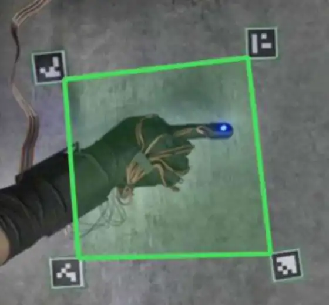</p>
<p align="center"><em>A finger approaching the edge: its marker changes color as the pulse speeds up, and the zone turns red when it leaves. <a href="docs/videos/demo-boundary-feedback.mp4">MP4 with sound</a> · <a href="docs/videos/full-procedure.mp4">Full walkthrough, 2 min</a></em></p>

**Pilot result (n = 1, the developer, 27 trials):** time spent outside the zone fell from **42%** with no feedback to **8%** with vibration and **5%** with vibration + sound, with no change in task time. This is an early trend, not a validated effect ([details](#pilot-study)).

## Problem

In procedures such as ultrasound-guided needle work, the clinician watches the imaging monitor while one hand holds the instrument. If that hand drifts a few centimetres outside the planned window, it can reach tissue that was never meant to be touched, and nothing tells them until they look down. A warning on a screen means looking away from the monitor, and a sound adds to a room already full of alarms and cannot say which finger is drifting or how close it is. Vibration on the fingertip is immediate, private and specific to the finger, and it needs no eyes or ears.

<p align="center">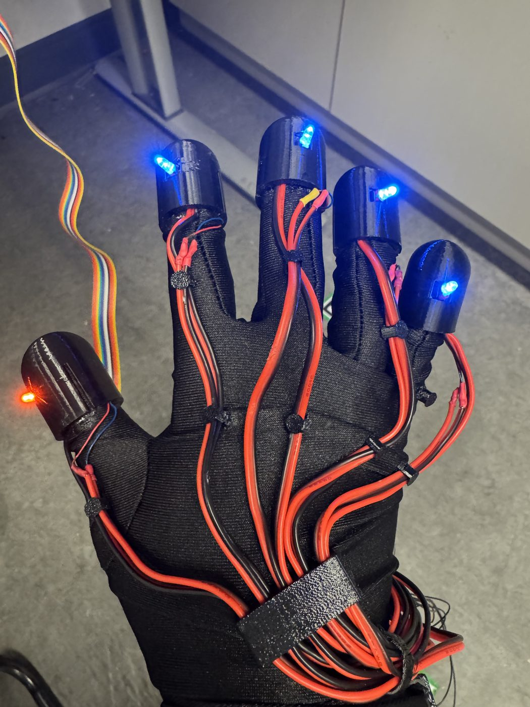 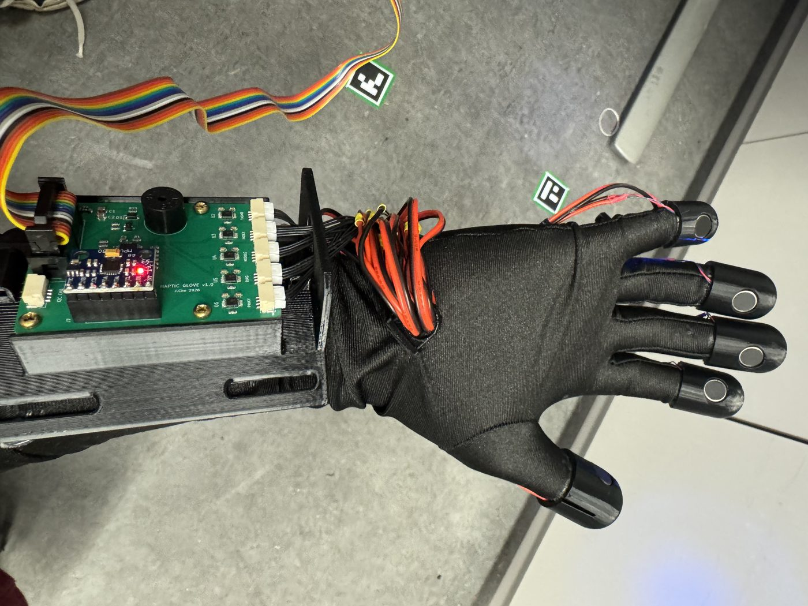</p>
<p align="center"><em>Fingertip LEDs and ERM motors, with a custom PCB in a 3D-printed forearm mount</em></p>

## How It Works

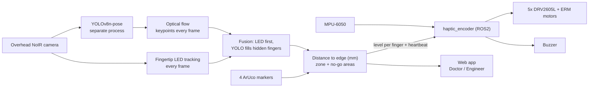

Each frame, the camera finds the fingertip LEDs, measures each finger's distance to the zone edge in millimetres (scaled from the known marker size), maps it to one of five warning levels inside a 50 mm band, and sends that level to the glove. Three design decisions shape the system:

**1. LEDs track the fingers; YOLO only fills the gaps.** LEDs are found in every frame (17-19 fps) with pixel precision, while YOLO takes ~0.6 s per inference on the Pi and is far less precise. YOLO, kept current by optical flow, covers only what LEDs cannot: curled fingers whose LEDs are hidden, and the whole hand leaving the zone.

**2. Distance is encoded as pulse rate, not strength.** Differences in ERM motor strength are hard to feel on the skin, while a change in rhythm is obvious. Like a parking sensor, the pulse period goes from 0.9 s to 0.22 s as the finger nears the edge, and becomes continuous once it is outside.

**3. Silence must never mean "safe".** If the vision process stops, the glove detects the missing heartbeat within 1 s and double-pulses all five fingers. A finger that loses its LED right at the edge counts as outside. In the app, fingers whose vibration is switched off stay visibly marked, so nobody mistakes a quiet glove for a safe hand.

<p align="center">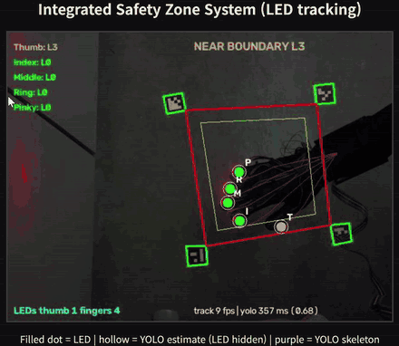</p>
<p align="center"><em>Engineer view (1.5x speed): filled dots are LEDs, hollow circles are YOLO estimates for fingers whose LEDs are hidden.</em></p>

The **web app** has a Doctor mode for the clinical team and an Engineer mode for tuning, plus no-go areas and an IMU steadiness monitor ([details](docs/ENGINEERING.md#web-app)).

<p align="center">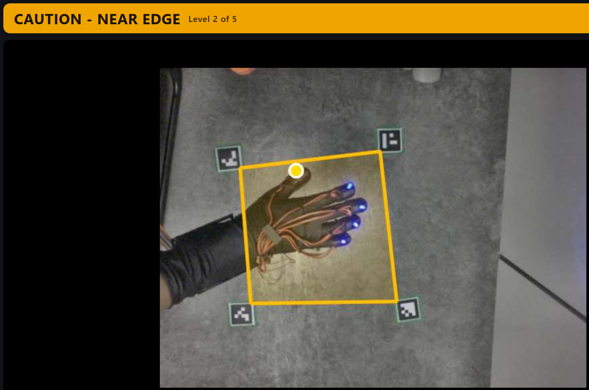 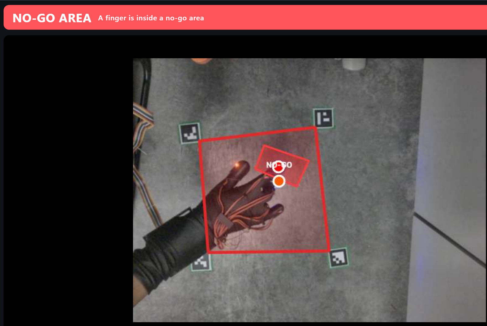</p>
<p align="center"><em>Doctor view: a finger near the edge (left) and inside a no-go area (right)</em></p>

## Key Specs

| | Value | Source |
|---|---|---|
| Fingertip tracking rate | 17-19 fps | measured (Engineer view) |
| Camera | 1280 x 960, capped at 20 fps | configured |
| YOLO inference (416 px, ONNX, Pi 4 CPU) | ~0.6 s | measured (640 px: ~1.2 s) |
| Warning band | 50 mm, 5 levels; pulse period 0.9 s to 0.22 s | configured |
| Distance resolution | ~3 mm per pixel (tracking runs on a 640 x 480 downscale of the 1280 x 960 frame to keep the loop at 17-19 fps; markers are detected at full resolution) | estimated from marker size |
| Haptic update loop / IMU sampling | 100 Hz / 100 Hz | configured |
| Vision heartbeat timeout | 1 s | configured |
| Camera-to-vibration latency (LED path) | ~150-250 ms | **estimated**, not yet measured end-to-end |

The latency estimate adds frame capture (up to ~50 ms), processing (~55 ms per frame), ROS2 messaging and the 100 Hz haptic loop (~10 ms), and ERM spin-up (~30-50 ms). **What it means:** at a typical 10 cm/s hand speed, 150-250 ms is 15-25 mm of travel, so the first warning still arrives with at least half of the 50 mm band left before the edge. Measuring the latency end-to-end is the next step.

## Pilot Study

**Task:** trace the inside edge of the zone once around with the index fingertip, staying as close to the edge as possible without going outside. Only the four markers are visible; the edge itself is not drawn on the table.

**Design:** 3 sessions × 3 conditions × 3 repetitions = 27 trials. The conditions are (1) glove only, with no feedback, (2) glove + vibration and (3) glove + vibration + sound. Each session used a different condition order (1>2>3, 2>3>1, 3>1>2) to balance out practice effects. All sessions were run by the developer.

<p align="center">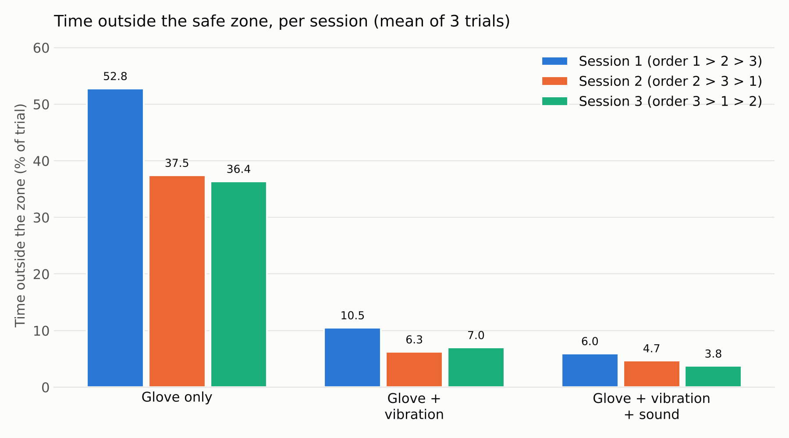</p>
<p align="center"><em>Time outside the zone in each session. The ranking (glove only > vibration > vibration + sound) is the same in all three orders.</em></p>

<p align="center">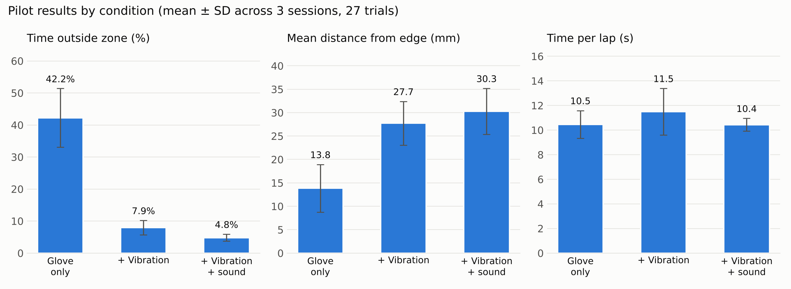</p>
<p align="center"><em>Mean ± SD across sessions. Feedback cut time outside sharply, roughly doubled the distance from the edge, and left lap time unchanged.</em></p>

- Vibration cut time outside the zone by **81%** (42.2% to 7.9%); adding sound cut it by **89%** (to 4.8%).
- The effect is not just practice: vibration + sound was the best condition even when it came first (3.8%), and glove-only stayed high even when it came last (37.5%).
- Lap time stayed at 10.4-11.5 s, so the feedback did not slow the task down.
- With feedback, the finger stayed about twice as far from the edge (14 mm to 28-30 mm). That conflicts with the task's "as close as possible" goal: in this setup the feedback mainly created a safety margin rather than tighter tracing.

**Limitations:** one participant who knows where the edge is, so the glove-only baseline may be optimistic; too few sessions for a statistical test; single-camera 2D tracking cannot measure the hand's height; tabletop task only.

**Next:** a study with 8-10 naive participants, end-to-end latency measurement, depth sensing for 3D boundaries, a separate motor power supply, and a test with clinicians on a simulation task.

Raw data and analysis: [`experiments/`](experiments). Full protocol and per-trial metrics: [`docs/ENGINEERING.md`](docs/ENGINEERING.md#experiment-mode).

## Top Engineering Challenges

| Challenge | Root cause | Solution |
|---|---|---|
| YOLO confidence stuck at 0.02 on the Pi | The capture pipeline swaps R and B, so the model saw the opposite channel order from training | A diagnostic script compared both orders and exposures on live frames; flipping the channels raised confidence to about 0.5 |
| Vibration far too weak | The DRV2605L drivers were left in LRA closed-loop mode, which is wrong for ERM motors | Device reset at startup, ERM mode, real-time playback with a minimum intensity floor |
| Five haptic drivers on one I2C bus | Every DRV2605L has the same fixed address (0x5A) | One TCA9548A multiplexer channel per driver, and one lock around every channel switch shared with the IMU |
| The glove went silent when tracking crashed | The glove had no way to know the camera side had stopped | A heartbeat from the vision process; after 1 s without it, the glove double-pulses all fingers |
| Validation scores looked too good | Neighboring video frames are nearly identical, so random splits leak | Train/validation split by whole recorded clips, never by random frames |

All 14 problems, the full development history (YOLO-only to LED + YOLO, jumper wires to PCB) and the training results are in [`docs/ENGINEERING.md`](docs/ENGINEERING.md).

<details>
<summary><b>Hardware</b></summary>

Raspberry Pi 4 (Ubuntu 24.04, ROS2 Jazzy) · 5x DRV2605L + ERM motors behind a TCA9548A I2C multiplexer · MPU-6050 IMU · fingertip LEDs (red thumb, blue fingers) · buzzer · Pi NoIR camera with IR LED ring · custom 66 x 52 mm PCB · 3D-printed forearm mount ([`hardware/forearm_mount/`](hardware/forearm_mount)). Pin and address reference: [`docs/ENGINEERING.md`](docs/ENGINEERING.md#hardware-reference).

<table>
<tr>
<td align="center">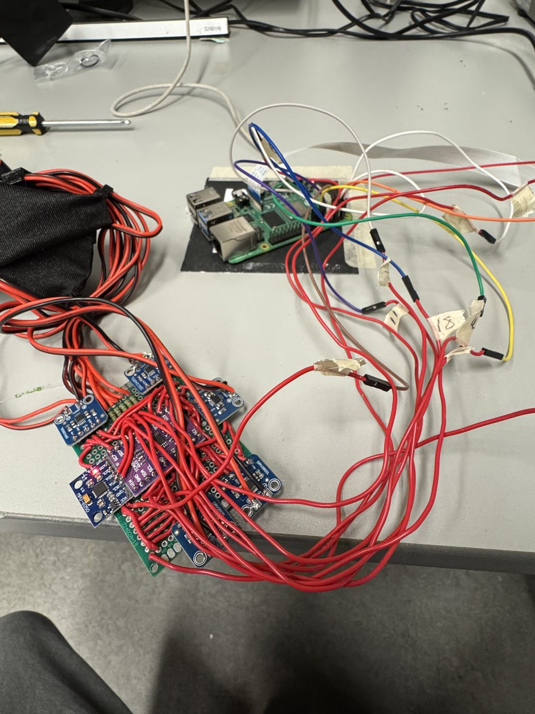<br><em>v1: jumper wires</em></td>
<td align="center">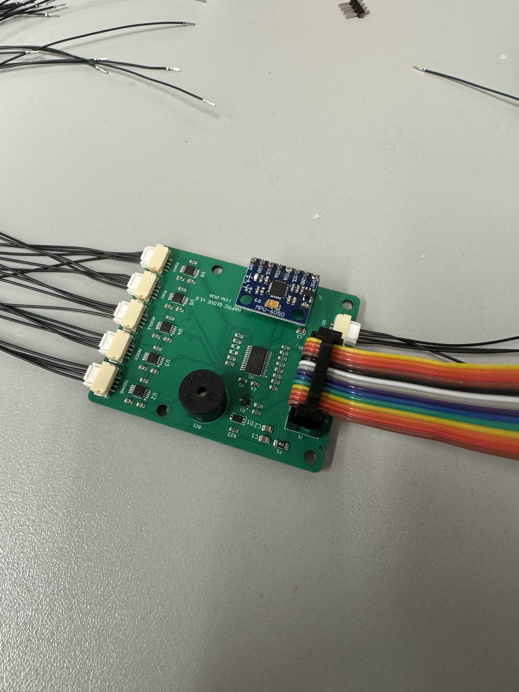<br><em>v2: custom PCB</em></td>
<td align="center">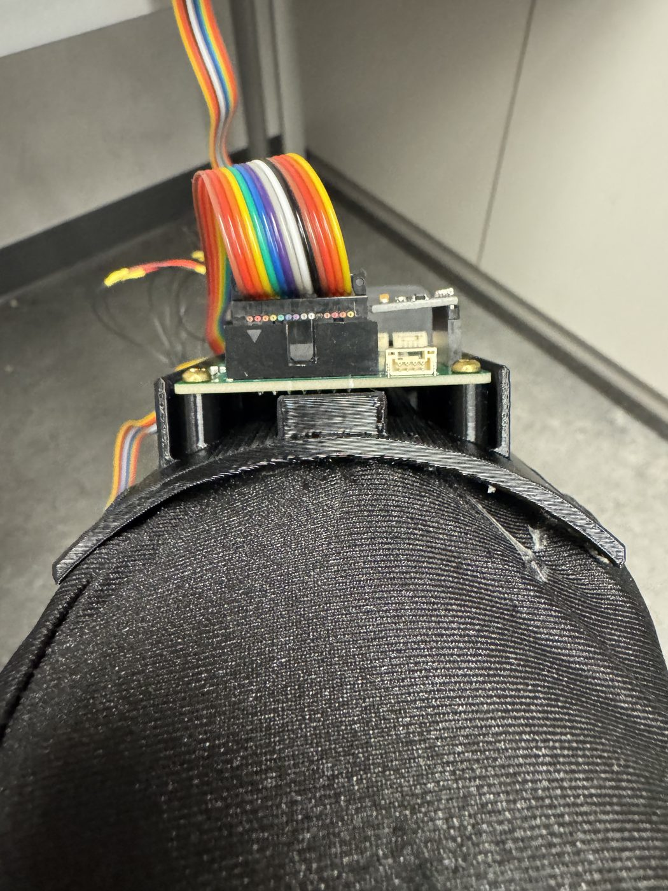<br><em>Vented forearm mount</em></td>
</tr>
</table>

</details>

<details>
<summary><b>Repository structure</b></summary>

```
pi/                    Runs on the Raspberry Pi
  integrated_safety.py   Main app: tracking, zone logic, web UI, experiment mode
  start_glove.sh         Starts the encoder and vision in tmux
  install_glove_service.sh   Installs the systemd auto-start service
  tools/                 LED calibration page, YOLO color/exposure diagnostic, LED test
  dataset/               Automated zone recording and zone-crop extraction
ros2_ws/src/haptic_encoder/   ROS2 node for motors, buzzer, LEDs, IMU, heartbeat
training/              Zone fine-tuning, dark retraining, small-input export, figures
  v1/                    v1 dataset tools, results and INT8 quantization
weights/               best_zone_dark_416.onnx (deployed), best_zone_dark.pt; v1/ has the v1 models
experiments/           Pilot study data and analysis script
hardware/forearm_mount/  CadQuery source, STL and STEP for the forearm mount
windows/HapticGlove.bat  One-click launcher (SSH tunnel and browser)
legacy/v1/             Archived v1 scripts and ROS2 nodes
docs/                  ENGINEERING.md, images and demo videos
```

</details>

<details>
<summary><b>Running</b></summary>

```bash
# On the Pi: build the encoder and copy the app and model
cd ros2_ws && colcon build && source install/setup.bash
cp pi/integrated_safety.py pi/start_glove.sh ~/
cp weights/best_zone_dark_416.onnx ~/

# Start (encoder + vision in tmux), or install the auto-start service once
bash ~/start_glove.sh
bash pi/install_glove_service.sh
```

Open `http://<pi-ip>:5005` for the app and `http://<pi-ip>:5005/exp` for the experiment page. If the network blocks the port, `windows/HapticGlove.bat` opens an SSH tunnel and the browser in one step (set the Pi address at the top of the file).

</details>
