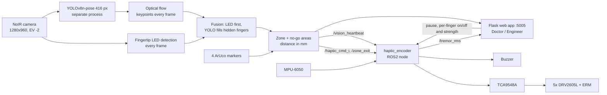

# Haptic Glove

A wearable haptic glove that warns the user before their hand leaves a defined work area. A camera tracks each fingertip against a zone marked by four ArUco markers, and the glove answers with per-finger vibration that pulses faster as a finger approaches the edge, plus a buzzer when the hand goes outside. Built for surgical-assist scenarios, where a clinician's eyes are on the procedure and not on a screen. Runs entirely on a Raspberry Pi 4 with ROS2.

<p align="center"></p>

<p align="center"></p>
<p align="center"><em>Approaching the edge: the fingertip marker changes color as the vibration pulse speeds up, and the zone turns red when the finger leaves it. <a href="docs/videos/demo-boundary-feedback.mp4">MP4 with sound</a></em></p>

**Pilot result:** with vibration feedback, time spent outside the zone dropped from **42% to 8%**, and to **5%** with vibration + sound, with no increase in task time ([details](#pilot-study)).

## Features

- **4-marker work zone**: four ArUco markers mark the corners of the work area; distances are measured in millimetres from the marker size
- **Hybrid fingertip tracking**: fingertip LEDs are the primary tracker (fast and precise); a custom **YOLOv8n-pose** model fills in fingers whose LEDs are hidden (e.g. a closed fist) and detects the whole hand leaving the zone
- **Real-time keypoints**: optical flow moves the YOLO keypoints every frame between model runs, so the skeleton follows fast hand motion instead of lagging by 1-2 s
- **Pulse-rate haptics**: 5 levels inside a 50 mm warning band, felt as a pulse that gets faster near the edge (like a parking sensor), continuous vibration outside, plus a buzzer on exit or sudden movement
- **No-go areas**: draw areas to avoid directly on the camera view; they are stored relative to the markers, so they stay in place if the camera moves
- **Tremor and steadiness monitoring**: 100 Hz IMU tremor band (4-12 Hz) plus camera-measured fingertip jitter, compared with a personal baseline; suggests a rest when steadiness drops
- **Fail-safe heartbeat**: if the vision process stops, the glove itself double-pulses all five fingers, so the user never mistakes "no vibration" for "safe"
- **Web app with Doctor / Engineer modes**: a clean, brightened camera view with large status banner for clinicians; raw detection view, live tuning and logs for engineers
- **Experiment mode**: built-in protocol for comparing feedback conditions (signals, counterbalancing, automatic metrics, CSV export)
- **Boots ready**: systemd service starts everything on power-up; a one-click Windows launcher opens the app

## Hardware

<table>
<tr>
<td align="center"><br><em>Forearm PCB, ERM motor under each fingertip</em></td>
<td align="center"><br><em>Glove inside the marker zone</em></td>
</tr>
<tr>
<td align="center"><br><em>Custom PCB</em></td>
<td align="center"><br><em>3D-printed forearm mount with ventilation gaps</em></td>
</tr>
</table>

| Component | Details |
|---|---|
| Compute | Raspberry Pi 4 (4 GB), Ubuntu Server 24.04, ROS2 Jazzy |
| Haptics | 5x DRV2605L (0x5A) + ERM motors, one under each fingertip, real-time playback (RTP) mode |
| I2C mux | TCA9548A (0x70): channels 0-4 for the haptic drivers, channel 5 for the IMU |
| IMU | MPU-6050 (0x68), sampled at 100 Hz |
| Fingertip LEDs | GPIO 22, 17, 27, 23, 24 (thumb to pinky); red on the thumb, blue on the other fingers |
| Buzzer | GPIO 18, 2 kHz software tone |
| Camera | Raspberry Pi NoIR camera (IMX708) with an IR LED ring, mounted overhead on a stand |
| Electronics | Custom 66 x 52 mm PCB on the forearm, ribbon cable to the Pi |
| Mount | 3D-printed forearm mount ([`hardware/forearm_mount/`](hardware/forearm_mount)): curved to the forearm, velcro strap slots, ventilation gaps, 2.5 mm pilot holes for self-tapping M3 screws, 20 mm wire exit at the wrist |

All five haptic drivers share one I2C address, so each sits on its own TCA9548A channel. Motor writes and the 100 Hz IMU reads run in the same node and share one `threading.Lock()`, so a channel switch never interleaves with another transaction.

<table>
<tr>
<td align="center"><br><em>Overhead camera with IR LED ring</em></td>
<td align="center"><br><em>IR illumination test in the dark</em></td>
<td align="center"><br><em>Full setup</em></td>
</tr>
</table>

## System Architecture



| Part | Role |
|---|---|
| [`pi/integrated_safety.py`](pi/integrated_safety.py) | Camera capture, LED + YOLO + optical-flow tracking, zone and no-go logic, fatigue monitor, experiment mode, web app |
| [`ros2_ws/src/haptic_encoder`](ros2_ws/src/haptic_encoder) | Drives the motors (pulse patterns, per-finger strength, pause), buzzer, LEDs, IMU tremor band and sudden-movement detection, heartbeat watchdog |

Detection and display are separate: tracking always runs on the raw, dark frame where the LEDs stand out, while the Doctor view gets its own color correction (R/B fix, gray-world white balance, gamma, CLAHE). Rendering takes about 5 ms in its own thread, so it never delays the haptic loop.

## Web App

<table>
<tr>
<td align="center"><br><em>Safe</em></td>
<td align="center"><br><em>Caution: near the edge</em></td>
</tr>
<tr>
<td align="center"><br><em>Outside the zone</em></td>
<td align="center"><br><em>Inside a no-go area</em></td>
</tr>
</table>

The **Doctor** view shows a brightened camera image, a large color-coded status banner, and fingertip dots only for fingers near the edge. The controls are made for an assistant: **Pause glove**, per-finger vibration on/off with a strength slider, buzzer on/off, zone lock, no-go areas, view rotation and session log download. Fingers that are switched off stay visibly marked so nobody mistakes silence for safety. If the connection drops, a full-screen warning (and an optional sound) appears.

<table>
<tr>
<td align="center"><br><em>Engineer view: fist with LEDs hidden; hollow circles are YOLO estimates</em></td>
<td align="center"><br><em>Setup wizard: markers, hand, baseline, feedback test</em></td>
</tr>
</table>

<table>
<tr>
<td align="center"><br><em>Fist detection: the hand is still caught leaving the zone with every LED hidden. <a href="docs/videos/demo-fist-detection.mp4">MP4</a></em></td>
<td align="center"><br><em>Drawing a no-go area on the live view. <a href="docs/videos/demo-nogo-zone.mp4">MP4</a></em></td>
</tr>
</table>

## Pilot Study

**Task:** trace the inside edge of the zone once around with the index fingertip, staying as close to the edge as possible without going outside. Only the four markers are visible; the edge itself is not drawn on the table.

**Conditions:** (1) glove only, no feedback; (2) glove + vibration; (3) glove + vibration + sound. Each condition was repeated 3 times, in three counterbalanced orders (1>2>3, 2>3>1, 3>1>2), for 27 trials. The experiment page gives the start/stop signals, switches the feedback automatically, ends each trial after one lap, and logs every metric. In experiment mode only the index finger gives feedback, the warning band is 20 mm, and the levels have 3 mm of hysteresis, so the feedback matches the task.

<p align="center"></p>
<p align="center"></p>
<p align="center"></p>

- Vibration cut the time spent outside the zone by **81%** (42.2% to 7.9%); adding sound cut it by **89%** (to 4.8%). The ranking was the same in all three sessions.
- The effect does not come from practice: vibration + sound was the best condition even when it was done first (3.8%), and glove-only stayed high even when it was done last (37.5%).
- Lap time did not change (10.4-11.5 s, Friedman p = 0.72), so the feedback did not slow the task down.
- With feedback, users kept about twice the distance from the edge (14 mm to 28-30 mm). Feedback mostly created a safety margin rather than tighter tracing.

**Limitations**
- All three sessions were run by one person, the developer, who knows where the edge is, so the glove-only baseline may be optimistic.
- The sample is too small to claim significance; with 3 sessions, a perfectly consistent ranking gives a Friedman p of only 0.05, which is a consistent trend, not a confirmed effect.
- Single-camera 2D tracking cannot tell how high the hand is above the table.
- Tabletop task only, not a clinical setting.

**Future work**
- User study with 8-10 naive participants, with a Friedman test and post-hoc comparisons
- Enough data to compare vibration against vibration + sound (currently 7.9% vs 4.8%)
- Depth sensing (stereo camera or IMU-based height) for 3D boundaries
- Separate power supply for the motors and active cooling for long sessions
- Evaluation with clinicians on a surgical simulation task

Raw data: [`experiments/experiment_results.csv`](experiments/experiment_results.csv). Figures: `python experiments/analyze_experiment.py experiments/experiment_results.csv --out docs/images`

## Development

### Hardware: jumper wires to PCB

<table>
<tr>
<td align="center"><br><em>v1: jumper wires to the Pi pulled loose whenever the hand moved</em></td>
<td align="center"><br><em>v1: hand-wired perfboard</em></td>
<td align="center"><br><em>v2: custom PCB with a single ribbon cable</em></td>
</tr>
</table>

### Tracking: from YOLO-only to LED + YOLO

1. **v1 model.** MediaPipe could not track the gloved hand (wires and fingertip caps break the bare-hand silhouette), so I trained a YOLOv8n-pose model on close-up gloved-hand clips. It scored well on its own validation set (pose mAP50-95 0.70) but scored **0.000 pose mAP50** on the real overhead work-zone view: the hand appears much smaller and darker there than in the training data.
2. **Zone data.** An automated script recorded 11 clips (20 s each) inside the four-marker zone, with a buzzer countdown between them. I cropped every 3rd frame to the zone plus a 35% margin (800 crops), labeled 21 keypoints in self-hosted CVAT with skeleton tracks, and fine-tuned on that data. Hand detection rose to 0.918 box mAP50.
3. **Darkness.** The LEDs need a dark exposure, and in the dark the model fell to 0.643. Retraining on the zone data with strong brightness augmentation, checked on a 0.125x-brightness copy of the validation set, brought dark detection to 0.916.
4. **LEDs first.** At ~1 s per inference on the Pi, YOLO alone was too slow and too uncertain to drive haptics. Fingertip LEDs became the primary tracker: the red thumb LED anchors the hand, and the four blue LEDs are ordered by chaining from the thumb. YOLO became the helper for hidden fingers and for the whole hand leaving the zone.
5. **Latency.** Keypoints lagged 2-3 s behind fast motion. Exporting at 416 px (YOLO ~1.2 s to ~0.6 s per inference, with better dark keypoint accuracy) and moving the keypoints with Lucas-Kanade optical flow between inferences made the skeleton follow the hand in real time.

<p align="center"></p>
<p align="center"><em>Exposure sweep (EV 0 to -3): a lower exposure isolates the LEDs cleanly while YOLO confidence stays usable. EV -2 was chosen as the balance.</em></p>

<p align="center"></p>

<p align="center"><br><em>21-keypoint labeling in self-hosted CVAT</em></p>

## Challenges & Solutions

| Challenge | Root cause | Solution |
|---|---|---|
| v1 model scored 0 on the real setup | Trained on close-up clips; in the overhead zone view the hand is small and dark | Recorded and labeled zone clips, fine-tuned, then retrained with brightness augmentation and a dark validation set |
| YOLO confidence stuck at 0.02 on the Pi | The capture pipeline swaps R and B; the model received the opposite channel order from training | Diagnostic script compared both orders and exposures on live frames; flipping the channels raised confidence to about 0.5 |
| Keypoints 2-3 s behind the hand | ~1.2 s per inference at 640 px, and stale keypoints were reused until the next result | 416 px model plus optical-flow propagation between inferences |
| Vibration far too weak | DRV2605L registers were left in LRA closed-loop mode, which is wrong for ERM motors | Device reset at startup, ERM mode, real-time playback with a minimum intensity floor |
| Strength changes were hard to feel | ERM amplitude differences are hard to tell apart on the skin | Encoded the level as pulse rate instead (0.9 s to 0.22 s period, continuous outside) |
| Camera crashed under CPU load | libcamera v0.2.0 IPA buffer assertion under heavy CPU load | YOLO moved to a separate process, 6 camera buffers, 20 fps cap, auto-restart loop, and a web page that reconnects by itself |
| Random restarts and throttling | Under-voltage and a 79 °C SoC temperature (`throttled=0xd0000`); the motors share the Pi's 5 V rail | Diagnosed with `vcgencmd`; heatsink/fan and a separate motor supply are the next hardware fix |
| Glove silent when the vision process died | No way for the glove to know that tracking had stopped | `/vision_heartbeat` watchdog in the encoder: after 1 s without it, all five fingers double-pulse |
| Buzzer sounded when only the wrist left the zone | The YOLO wrist keypoint counted as part of the hand | Wrist keypoint excluded from the exit check |
| False alarms during the tracing experiment | A 50 mm band, all five fingers and the lost-LED rule fired while the user was tracing correctly | Experiment-only settings: 20 mm band, index finger only, 3 mm hysteresis, lost-LED rule off |
| Glove-only trials under-counted time outside | Fingers that went far outside were lost by the tracker and not counted | A finger last seen outside counts as outside until it is seen again; a validity flag marks trials with low tracking |
| Five haptic drivers on one I2C bus | Every DRV2605L has the same fixed address (0x5A) | One TCA9548A channel per driver, IMU on channel 5, one lock around every channel switch |
| Inflated validation scores | Neighboring video frames are nearly identical | Validation split by whole clips, never by random frames |
| `onnxruntime` crashed on the Pi | Bus error in newer releases on the Pi 4 | Pinned `onnxruntime==1.18.1` and added a 2 GB swap file |

## Repository Structure

```
pi/                    Runs on the Raspberry Pi
  integrated_safety.py   Main app: tracking, zone logic, web UI, experiment mode
  start_glove.sh         Starts the encoder and vision in tmux
  install_glove_service.sh   Installs the systemd auto-start service
  tools/                 LED calibration page, YOLO color/exposure diagnostic, LED test
  dataset/               Automated zone recording and zone-crop extraction
ros2_ws/src/haptic_encoder/   ROS2 node for motors, buzzer, LEDs, IMU, heartbeat
training/              Zone fine-tuning, dark retraining, small-input export, figures
  v1/                    v1 dataset tools, results and INT8 quantization
weights/               best_zone_dark_416.onnx (deployed) and best_zone_dark.pt; v1/ has the v1 models
experiments/           Pilot study data and analysis script
hardware/forearm_mount/  CadQuery source, STL and STEP for the forearm mount
windows/HapticGlove.bat  One-click launcher (SSH tunnel and browser)
legacy/v1/             Archived v1 scripts and ROS2 nodes
docs/                  Images and demo videos for this README
```

## Running

```bash
# On the Pi: build the encoder and copy the app and model
cd ros2_ws && colcon build && source install/setup.bash
cp pi/integrated_safety.py pi/start_glove.sh ~/
cp weights/best_zone_dark_416.onnx ~/

# Start (encoder + vision in tmux), or install the auto-start service once
bash ~/start_glove.sh
bash pi/install_glove_service.sh
```

Open `http://<pi-ip>:5005` for the app and `http://<pi-ip>:5005/exp` for the experiment page. If the network blocks the port, `windows/HapticGlove.bat` opens an SSH tunnel and the browser in one step (set the Pi address at the top of the file).

<details>
<summary><b>v1 model training and INT8 quantization</b></summary>

The v1 YOLOv8n-pose model was trained on 3,332 close-up gloved-hand frames (18 clips, 150 epochs), with validation split by whole CVAT jobs. It reached pose mAP50-95 0.698 and box mAP50-95 0.876 on that data. Scripts and plots are in [`training/v1/`](training/v1).

To run it faster on the Pi, the model was quantized to INT8:

| | FP32 | INT8 (static) |
|---|---|---|
| Model size | 13.9 MB | **7.3 MB** (-47%) |
| Latency on Raspberry Pi 4 | 518-628 ms | **382-491 ms** (-22 to -26%) |
| Pose mAP50-95 | 0.703 | **0.700** |

1. Dynamic quantization made the model **slower** (0.71x): it recomputes activation ranges on every run and maps convolutions to slower `ConvInteger` kernels.
2. Static quantization collapsed accuracy to **0 mAP**: the output head packs box coordinates (0-640) and confidences (0-1) into one tensor, and a single 8-bit scale rounds every confidence to zero.
3. Keeping the output head (`/model.22/`) in FP32 restored full accuracy while keeping the speedup.

The current system uses the FP32 416 px zone model, because the zone retraining mattered far more for accuracy than quantization did for speed.

</details>
