# Engineering Notes

Detailed reference for the [Haptic Glove](../README.md): hardware, how the tracking evolved, every problem solved along the way, the web app, and the v1 model work.

- [Hardware reference](#hardware-reference)
- [Development history](#development-history)
- [All challenges and solutions](#all-challenges-and-solutions)
- [Web app](#web-app)
- [Experiment mode](#experiment-mode)
- [v1 model and INT8 quantization](#v1-model-and-int8-quantization)

## Hardware reference

| Component | Details |
|---|---|
| Compute | Raspberry Pi 4 (4 GB), Ubuntu Server 24.04, ROS2 Jazzy |
| Haptics | 5x DRV2605L (0x5A) + ERM motors, one under each fingertip, real-time playback (RTP) mode |
| I2C mux | TCA9548A (0x70): channels 0-4 for the haptic drivers, channel 5 for the IMU |
| IMU | MPU-6050 (0x68), sampled at 100 Hz |
| Fingertip LEDs | GPIO 22, 17, 27, 23, 24 (thumb to pinky); red on the thumb, blue on the other fingers |
| Buzzer | GPIO 18, 2 kHz software tone |
| Camera | Raspberry Pi NoIR camera (IMX708) with an IR LED ring, mounted overhead on a stand |
| Electronics | Custom 66 x 52 mm PCB on the forearm, ribbon cable to the Pi |
| Mount | 3D-printed forearm mount ([`hardware/forearm_mount/`](../hardware/forearm_mount)): curved to the forearm, velcro strap slots, ventilation gaps, 2.5 mm pilot holes for self-tapping M3 screws, 20 mm wire exit at the wrist |

All five haptic drivers share one I2C address, so each sits on its own TCA9548A channel. Motor writes and the 100 Hz IMU reads run in the same node and share one `threading.Lock()`, so a channel switch never interleaves with another transaction.

<table>
<tr>
<td align="center">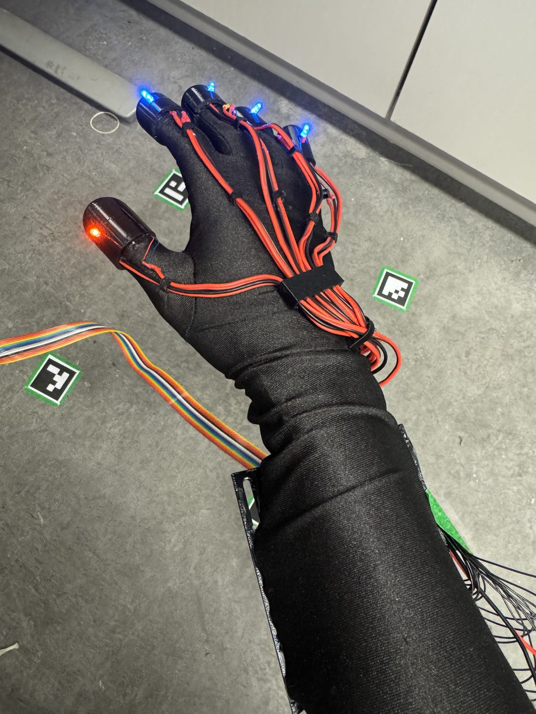 <em>Glove inside the marker zone</em></td>
<td align="center">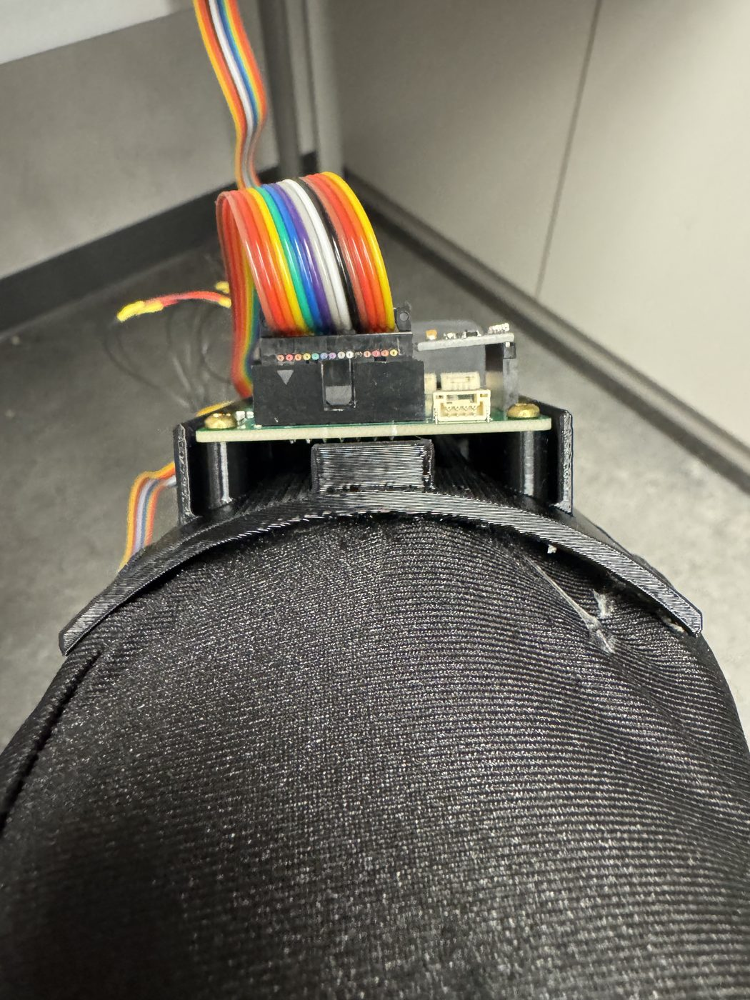 <em>Forearm mount with ventilation gaps</em></td>
<td align="center">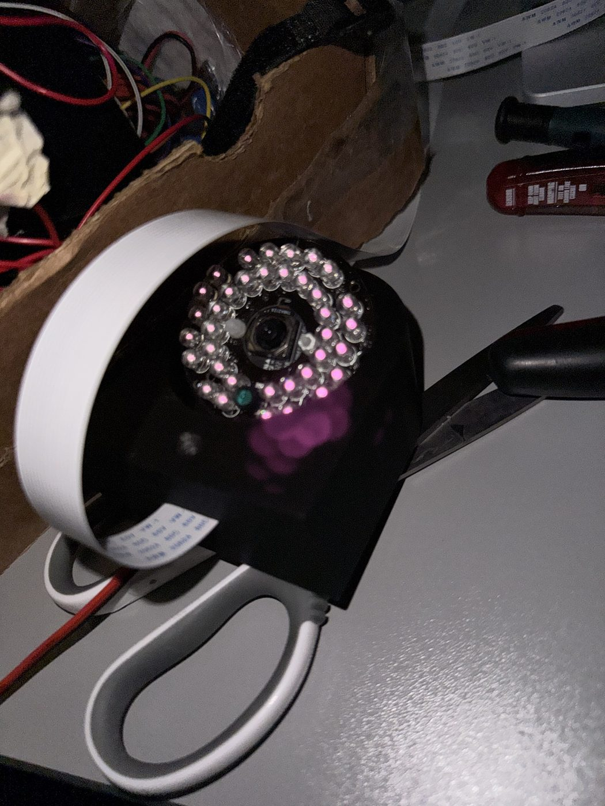 <em>IR illumination test in the dark</em></td>
</tr>
<tr>
<td align="center">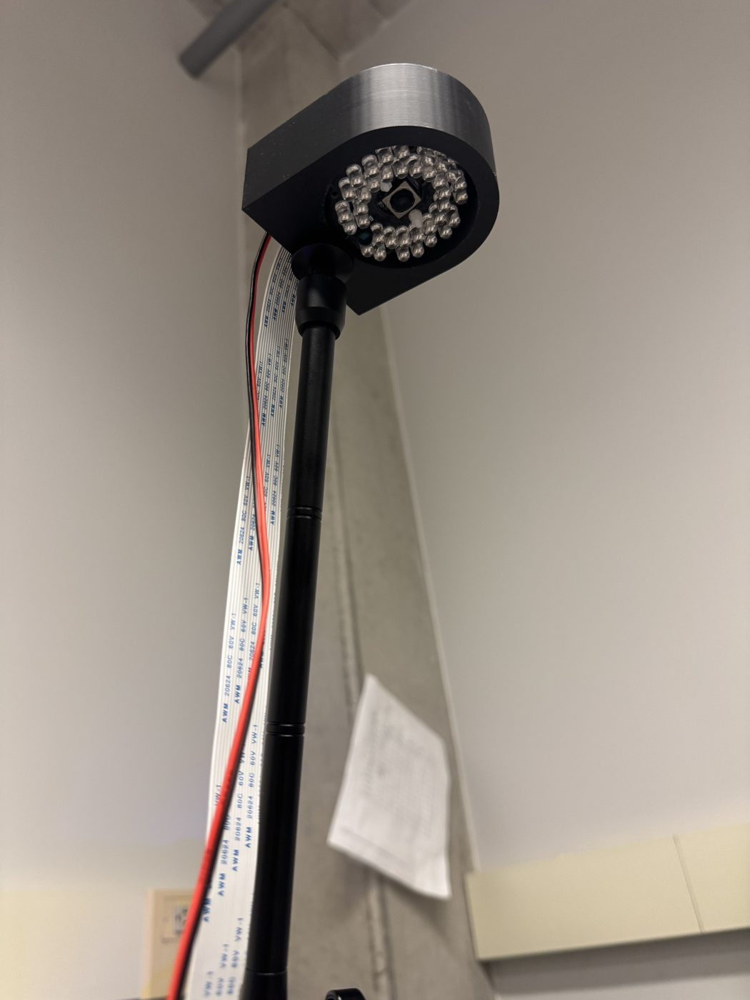 <em>Overhead camera with IR LED ring</em></td>
<td align="center">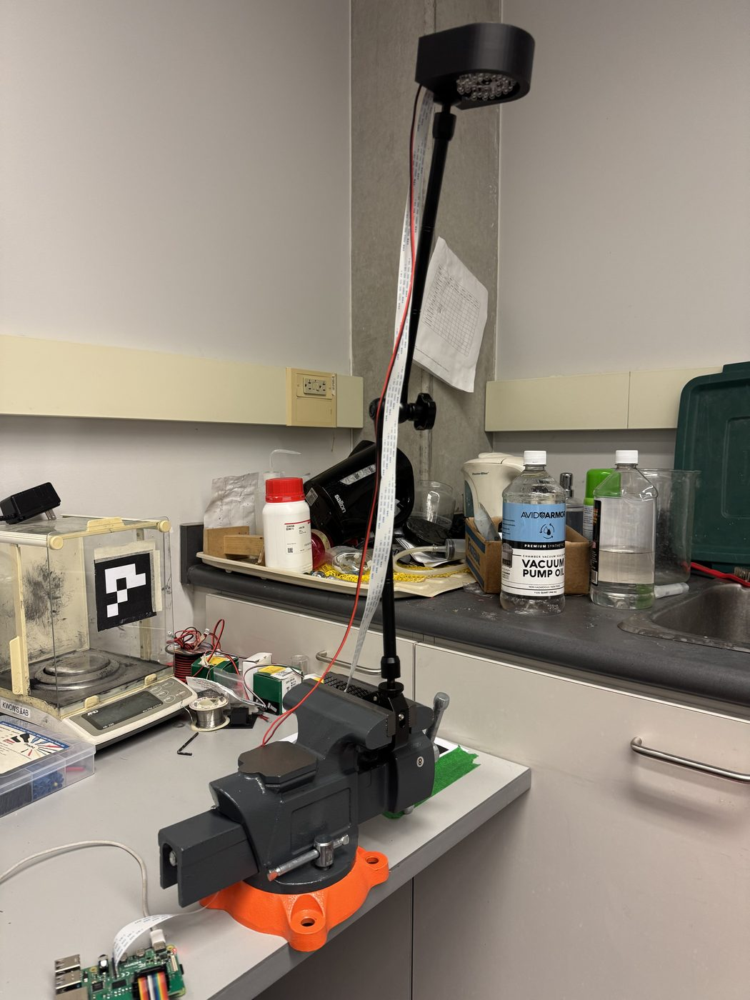 <em>Full setup</em></td>
<td align="center">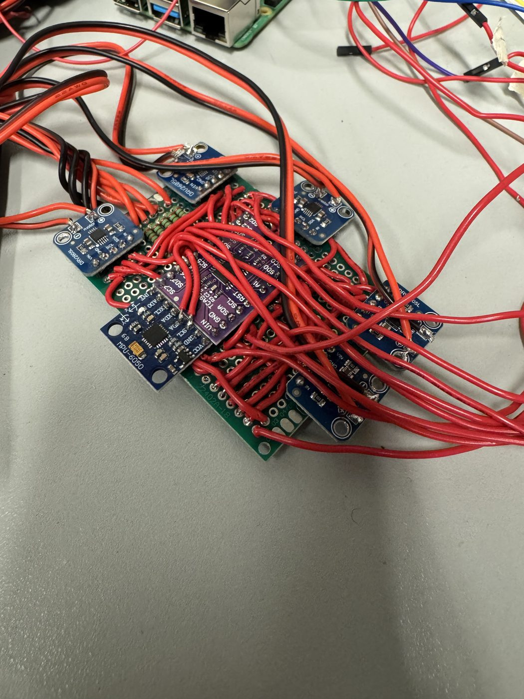 <em>v1 hand-wired perfboard</em></td>
</tr>
</table>

## Development history

### Hardware: jumper wires, perfboard, PCB

The first prototype connected everything to the Pi with jumper wires, which pulled loose whenever the hand moved. A hand-wired perfboard came next, and finally a custom PCB with a single ribbon cable, mounted on a 3D-printed forearm shell.

### Tracking: from YOLO-only to LED + YOLO

1. **v1 model.** MediaPipe could not track the gloved hand (wires and fingertip caps break the bare-hand silhouette), so a YOLOv8n-pose model was trained on close-up gloved-hand clips. It scored well on its own validation set (pose mAP50-95 0.70) but **0.000 pose mAP50** on the real overhead work-zone view, where the hand is much smaller and darker.
2. **Zone data.** An automated script ([`pi/dataset/record_zone_auto.py`](../pi/dataset/record_zone_auto.py)) recorded 11 clips of 20 s inside the four-marker zone with a buzzer countdown. Every 3rd frame was cropped to the zone plus a 35% margin (800 crops), labeled with 21 keypoints in self-hosted CVAT using skeleton tracks, and used for fine-tuning. Hand detection rose to 0.918 box mAP50.
3. **Darkness.** The LEDs need a dark exposure, and in the dark the model fell to 0.643. Retraining with strong brightness augmentation, checked on a 0.125x-brightness copy of the validation set, brought dark detection to 0.916.
4. **LEDs first.** At about 1 s per inference on the Pi, YOLO alone was too slow and too uncertain to drive haptics. Fingertip LEDs became the primary tracker; YOLO became the helper for hidden fingers and for the whole hand leaving the zone.
5. **Latency.** Keypoints lagged 2-3 s behind fast motion. A 416 px export (about 1.2 s to 0.6 s per inference, with better dark keypoint accuracy) plus Lucas-Kanade optical flow between inferences made the skeleton follow the hand in real time.

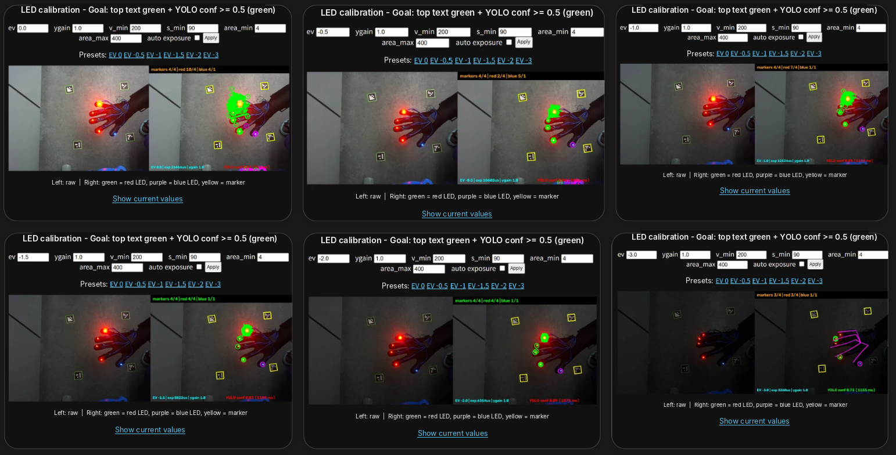

<em>Exposure sweep (EV 0 to -3): a lower exposure isolates the LEDs while YOLO confidence stays usable. EV -2 was chosen as the balance.</em>

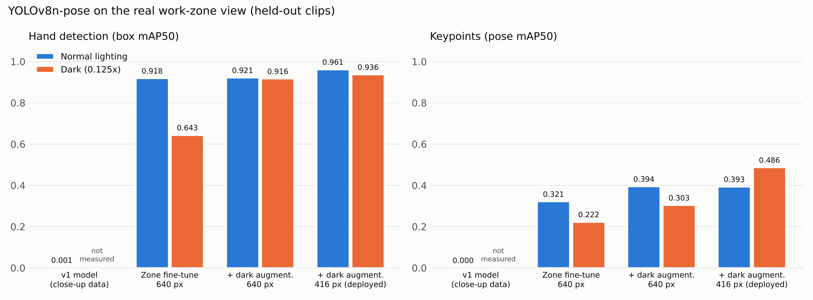

<em>Each training step on the real work-zone view. Blue: normal lighting. Orange: the same frames at 0.125x brightness.</em>

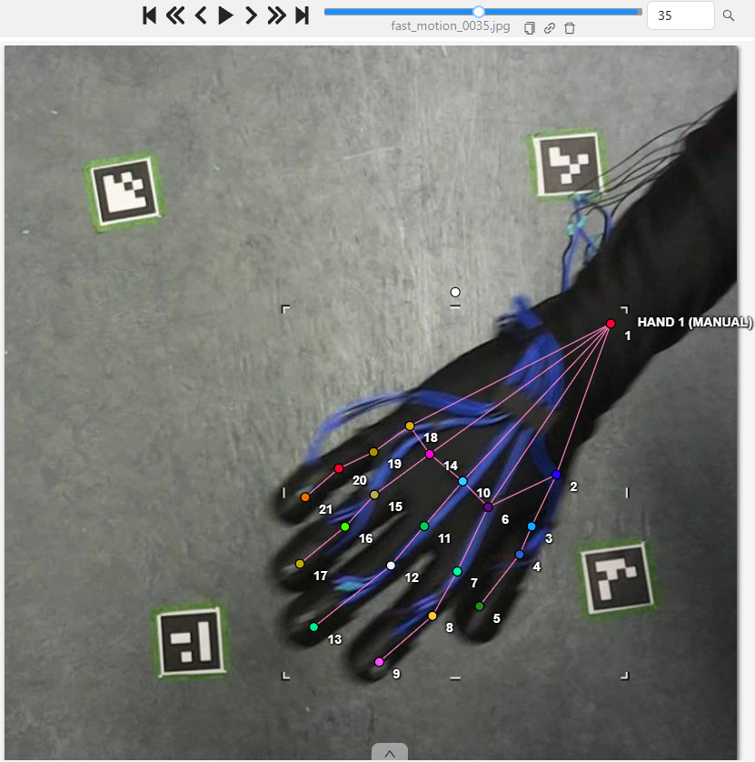 <em>21-keypoint labeling in self-hosted CVAT</em>

## All challenges and solutions

| Challenge | Root cause | Solution |
|---|---|---|
| v1 model scored 0 on the real setup | Trained on close-up clips; in the overhead zone view the hand is small and dark | Recorded and labeled zone clips, fine-tuned, then retrained with brightness augmentation and a dark validation set |
| YOLO confidence stuck at 0.02 on the Pi | The capture pipeline swaps R and B; the model received the opposite channel order from training | A diagnostic script ([`pi/tools/yolo_diag.py`](../pi/tools/yolo_diag.py)) compared both orders and exposures on live frames; flipping the channels raised confidence to about 0.5 |
| Keypoints 2-3 s behind the hand | About 1.2 s per inference at 640 px, and stale keypoints were reused until the next result | 416 px model plus optical-flow propagation between inferences |
| Vibration far too weak | DRV2605L registers were left in LRA closed-loop mode, which is wrong for ERM motors | Device reset at startup, ERM mode, real-time playback with a minimum intensity floor |
| Strength changes were hard to feel | ERM amplitude differences are hard to tell apart on the skin | Level encoded as pulse rate (0.9 s to 0.22 s period, continuous outside) |
| Camera crashed under CPU load | libcamera v0.2.0 IPA buffer assertion under heavy CPU load | YOLO in a separate process, 6 camera buffers, 20 fps cap, auto-restart loop, and a web page that reconnects by itself |
| Random restarts and throttling | Under-voltage and a 79 °C SoC temperature (`throttled=0xd0000`); the motors share the Pi's 5 V rail | Diagnosed with `vcgencmd`; a heatsink/fan and a separate motor supply are the next hardware fix |
| Glove silent when the vision process died | The glove had no way to know that tracking had stopped | `/vision_heartbeat` watchdog in the encoder: after 1 s without it, all five fingers double-pulse |
| Buzzer sounded when only the wrist left the zone | The YOLO wrist keypoint counted as part of the hand | Wrist keypoint excluded from the exit check |
| False alarms during the tracing experiment | A 50 mm band, all five fingers and the lost-LED rule fired while the user was tracing correctly | Experiment-only settings: 20 mm band, index finger only, 3 mm hysteresis, lost-LED rule off |
| Glove-only trials under-counted time outside | Fingers that went far outside were lost by the tracker and not counted | A finger last seen outside counts as outside until it is seen again; a validity flag marks trials with low tracking |
| Five haptic drivers on one I2C bus | Every DRV2605L has the same fixed address (0x5A) | One TCA9548A channel per driver, IMU on channel 5, one lock around every channel switch |
| Inflated validation scores | Neighboring video frames are nearly identical | Validation split by whole clips, never by random frames |
| `onnxruntime` crashed on the Pi | Bus error in newer releases on the Pi 4 | Pinned `onnxruntime==1.18.1` and added a 2 GB swap file |

## Web app

The Flask app on port 5005 has two modes. **Doctor** shows a brightened, color-corrected camera view, a large color-coded status banner (safe, caution, outside, no-go, paused, tracking lost), and fingertip dots only for fingers near the edge. **Engineer** shows the raw detection view with LED blobs, YOLO skeleton, frame rates, the event log and live tuning (camera brightness, LED strictness, view brightness and detail).

Controls are made for an assistant: **Pause glove**, per-finger vibration on/off with a 20-100% strength slider, buzzer on/off, zone lock and re-detect, no-go areas, view rotation and mirroring, new session and log download. A setup wizard walks through marker placement, hand detection, a 30 s steadiness baseline and a vibration test. If the connection drops, a full-screen warning (and an optional sound) appears.

<table>
<tr>
<td align="center">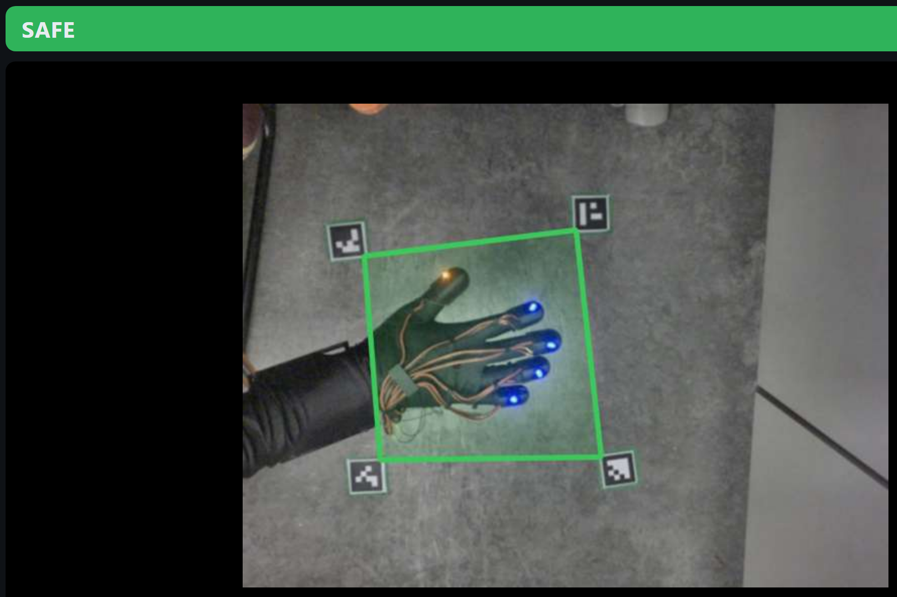 <em>Safe</em></td>
<td align="center">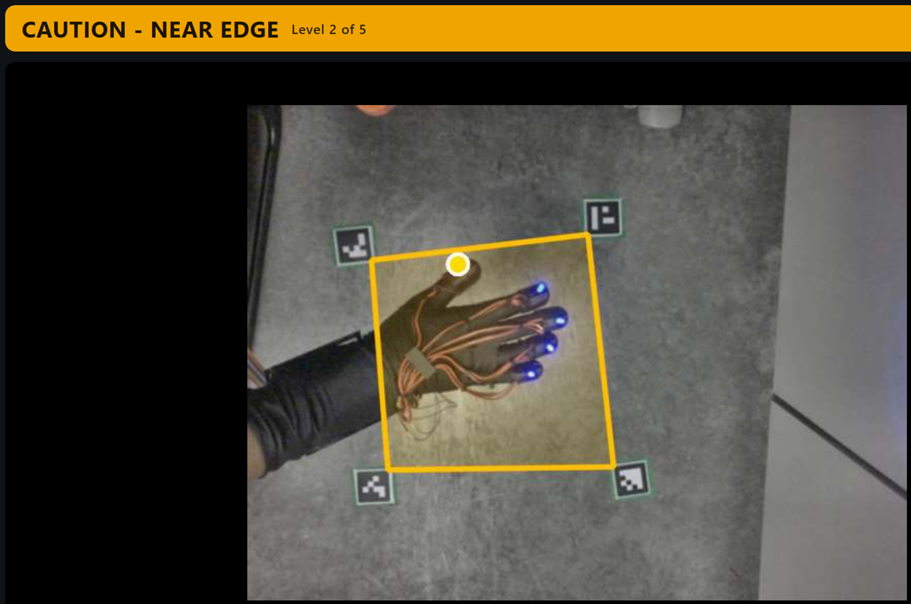 <em>Caution</em></td>
</tr>
<tr>
<td align="center">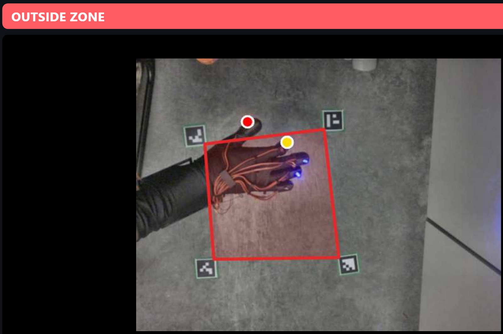 <em>Outside the zone</em></td>
<td align="center">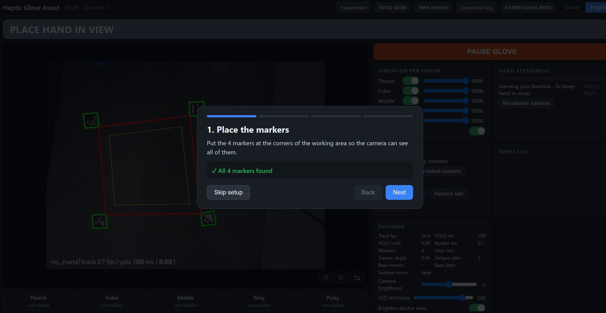 <em>Setup wizard</em></td>
</tr>
<tr>
<td align="center">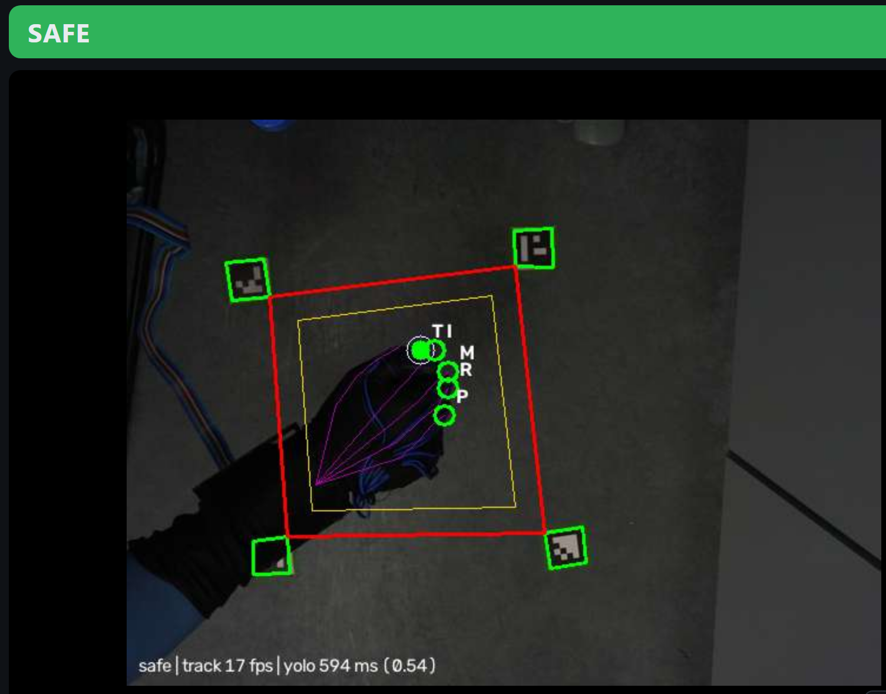 <em>Engineer view: fist with LEDs hidden; hollow circles are YOLO estimates</em></td>
<td align="center">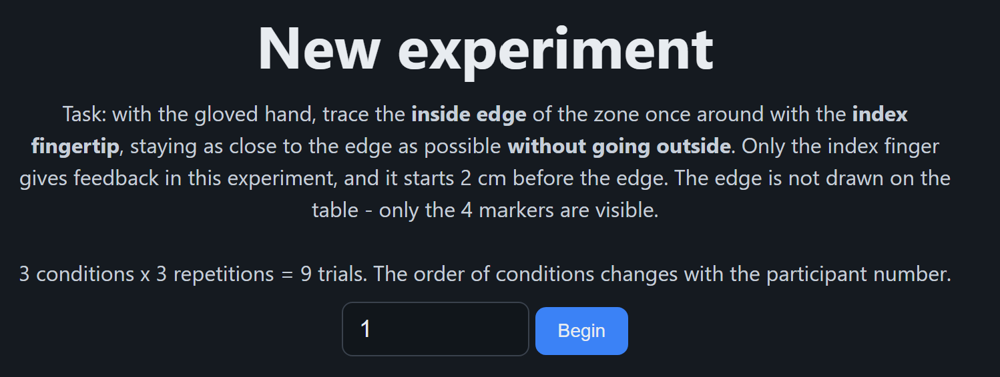 <em>Experiment page</em></td>
</tr>
</table>

<table>
<tr>
<td align="center">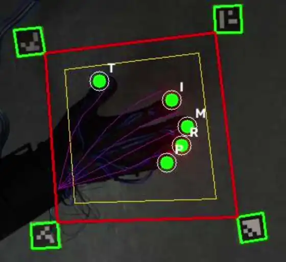 <em>Fist detection with every LED hidden. <a href="videos/demo-fist-detection.mp4">MP4</a></em></td>
<td align="center">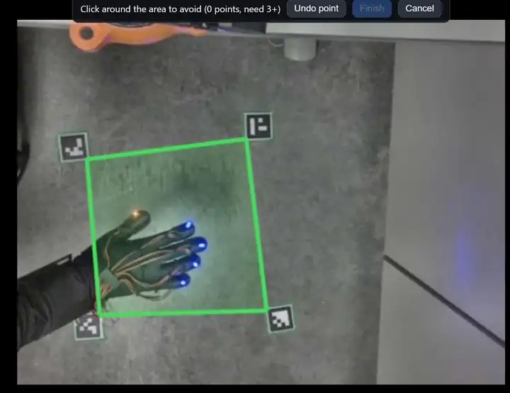 <em>Drawing a no-go area on the live view. <a href="videos/demo-nogo-zone.mp4">MP4</a></em></td>
</tr>
</table>

## Experiment mode

`http://<pi-ip>:5005/exp` runs the pilot protocol. The participant number sets a counterbalanced condition order (1>2>3, 2>3>1, 3>1>2). The page gives a 3-2-1 countdown with beeps, a GO signal and a STOP signal, switches the feedback for each condition automatically, and ends a trial after one lap around the zone centre (or after 2 minutes). Trials with less than 70% tracking or an unfinished lap are flagged for a redo.

Experiment-only settings, so the feedback matches the tracing task: only the index finger gives feedback, the warning band is 20 mm instead of 50 mm, levels have 3 mm of hysteresis, and the lost-LED fail-safe rule is off. Logged per trial: time outside (total and tracked-only), time in the 0-20 mm band, exits, mean and minimum distance to the edge, warning count (and how many came from YOLO estimates), vibration time, tracking rate, and tremor measured only while the motors are off.

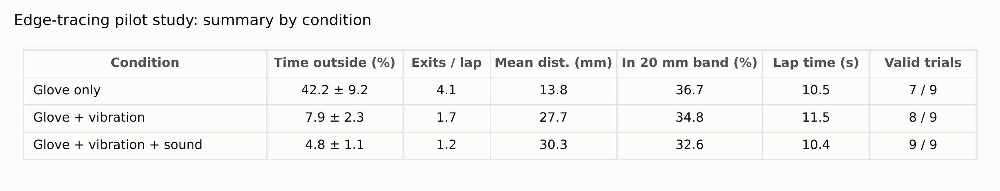

<em>Pilot summary by condition (3 sessions, 27 trials).</em>

## v1 model and INT8 quantization

The v1 YOLOv8n-pose model was trained on 3,332 close-up gloved-hand frames (18 clips, 150 epochs), with validation split by whole CVAT jobs. It reached pose mAP50-95 0.698 and box mAP50-95 0.876 on that data. Scripts and plots are in [`training/v1/`](../training/v1).

| | FP32 | INT8 (static) |
|---|---|---|
| Model size | 13.9 MB | **7.3 MB** (-47%) |
| Latency on Raspberry Pi 4 | 518-628 ms | **382-491 ms** (-22 to -26%) |
| Pose mAP50-95 | 0.703 | **0.700** |

1. Dynamic quantization made the model **slower** (0.71x): it recomputes activation ranges on every run and maps convolutions to slower `ConvInteger` kernels.
2. Static quantization collapsed accuracy to **0 mAP**: the output head packs box coordinates (0-640) and confidences (0-1) into one tensor, and a single 8-bit scale rounds every confidence to zero.
3. Keeping the output head (`/model.22/`) in FP32 restored full accuracy while keeping the speedup.

The current system uses the FP32 416 px zone model, because the zone retraining mattered far more for accuracy than quantization did for speed.
